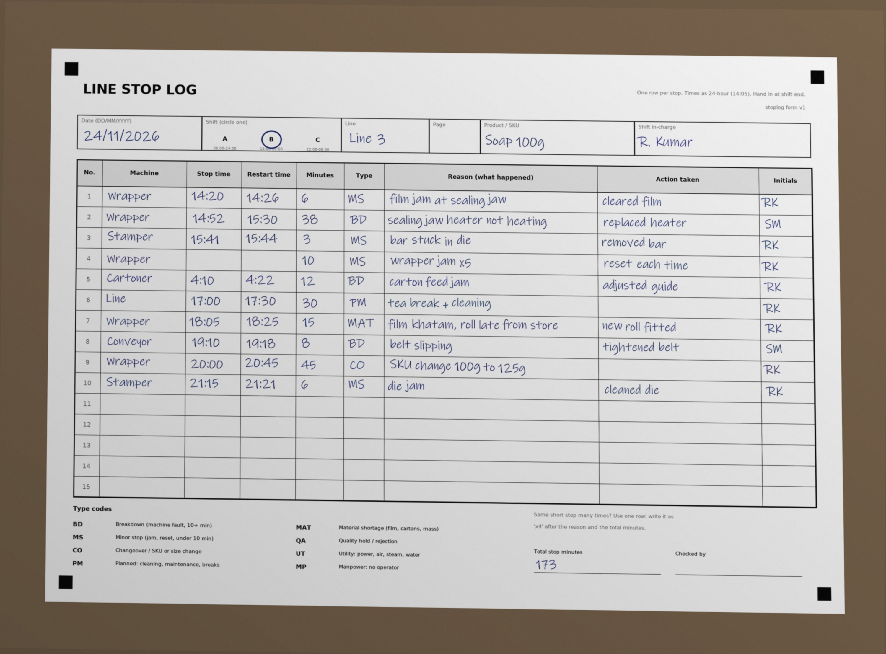

# stoplog

**stoplog reads photos of handwritten line-stop sheets and keeps a Google Sheet of every stop up to date, with a tab that shows where the line is losing time.**

A camera (a Raspberry Pi camera pointed at the sheet, or phone photos dropped into a folder) captures the paper loss sheet. A vision model (OpenAI or Claude) transcribes each row. stoplog cleans the rows with the plant's own rules, appends new stops to the sheet, and rebuilds an Insights tab: top loss causes, the most frequent minor stops, splits by machine, shift, line and hour, trends, and a short plain-English read of the numbers.



## Why

In many plants, operators write stops on a loose sheet and the shift officer re-types it into Excel at the end of the shift. The exact time and cause of each stop rarely survive the re-typing, and the short, frequent stops that cost the most are the ones most often lost. stoplog removes the re-typing and keeps the detail.

## What it does

| Step | What happens |
|---|---|
| Capture | Pi camera takes a photo every N minutes. A photo is only sent if the sheet changed. Phone photos dropped in the inbox folder work too. |
| Read | The model transcribes every row into a fixed schema (structured outputs, so no free-text scraping). |
| Clean | One rule for every row: equipment stops under 10 min are minor stops, longer ones breakdowns, whatever box was ticked. 12-hour times are fixed using the shift ("4:10" on the 14:00 to 22:00 shift is 16:10). Night shifts that cross midnight are dated correctly. Tallies like "x5" become five stops. |
| Check | Rows where the written minutes disagree with the clock times, times fall outside the shift, or the read was unsure are flagged `needs_review` with the reason. |
| Dedupe | A second photo of the same sheet later in the shift only adds the new rows. The same file is never read twice. |
| Append | New stops go to the `Log` tab, each photo to the `Photos` tab. |
| Infer | The `Insights` tab is rebuilt from the `Log` tab, so a correction typed into the sheet flows straight into the insights. |

The numbers on the Insights tab are computed in code. The model only writes the short findings, and any finding that quotes a number not in the computed tables is dropped before it reaches the sheet.

## The sheet

stoplog reads any stop sheet, but it is tuned for the **Line Stop Log** in [`forms/line-stop-log.pdf`](forms/line-stop-log.pdf) (A4 landscape). Its columns follow what common downtime and breakdown logs record: machine, stop time, restart time, minutes, a type code, the reason, the action taken, and initials, with the shift circled in the header and the type-code legend printed at the bottom.

Print one with your own shifts and minor-stop rule on it:

```
stoplog print-form line-stop-log.pdf
```

Type codes: `BD` breakdown, `MS` minor stop, `CO` changeover, `PM` planned (cleaning, maintenance, breaks), `MAT` material shortage, `QA` quality hold, `UT` utility (power, air, steam), `MP` manpower. Planned stops are kept in the log but are not ranked as losses.

## Quick start (laptop, no Google account needed)

```
git clone https://github.com/GuraseesWasNotAvailable/stoplog
cd stoplog
python -m venv .venv
.venv/bin/pip install -e ".[dev]"        # Windows: .venv\Scripts\pip
cp config.example.env.txt .env           # put OPENAI_API_KEY (or ANTHROPIC_API_KEY) in it

stoplog extract samples/line3-shiftB.jpg          # print what it reads, writes nothing
stoplog --store csv process samples/line3-shiftB.jpg
stoplog --store csv insights                      # see stoplog-data/insights.csv
```

`samples/line3-shiftB.truth.json` holds what a perfect read of the sample returns, so you can check a model against it.

## Google Sheet setup

### Easiest: your own Google account (no Cloud project)

A small Apps Script inside the sheet reads and writes it as you.

1. Open the sheet, then **Extensions > Apps Script**. Replace the code with [`deploy/google-apps-script/stoplog-bridge.gs`](deploy/google-apps-script/stoplog-bridge.gs) and save.
2. **Deploy > New deployment**, type **Web app**, Execute as **Me**, Who has access **Anyone**, then **Deploy** and authorize (Google shows "unverified app" for your own scripts: Advanced, then Go to the project).
3. Put the Web app URL (ends in `/exec`) in the environment as `STOPLOG_WEBAPP_URL`, and set `store: webapp` in `stoplog.yaml` (or `STOPLOG_STORE=webapp`).
4. `stoplog init` creates the tabs.

Treat the web app URL like a password: anyone who has it can read the log and add rows. To revoke it, archive the deployment (Deploy > Manage deployments) and make a new one.

### Alternative: service account

1. Create an empty Google Sheet and copy its URL into `STOPLOG_SHEET_ID` in `.env`.
2. In Google Cloud Console: create a project, enable the **Google Sheets API**, create a **service account**, and download a JSON key. Save it next to `.env` and set `GOOGLE_CREDENTIALS_FILE`.
3. Share the sheet with the service account's email (it is in the JSON, `client_email`) as **Editor**.
4. Run `stoplog init`. It checks the key, opens the sheet, and creates the `Log`, `Photos` and `Insights` tabs.

A Desktop-app OAuth client JSON also works in place of a service account; it opens a browser once and saves the token in `.stoplog/`.

Keep the JSON key and `.env` out of git (both are in `.gitignore`). If a key is ever pasted somewhere public, rotate it.

## Raspberry Pi

Target: Pi 4 or 5, Raspberry Pi OS Bookworm or newer (64-bit), Camera Module 3 or a USB webcam. The install script and service have not yet been run on Pi hardware; report anything that breaks.

```
git clone https://github.com/GuraseesWasNotAvailable/stoplog && cd stoplog
bash deploy/install-rpi.sh        # venv, camera tools, systemd service
nano .env                         # keys, sheet id
nano stoplog.yaml                 # shifts, lines, machines, your reason vocabulary
.venv/bin/stoplog init
.venv/bin/stoplog capture-test    # look at capture-test.jpg: whole sheet in frame, sharp, even light
sudo systemctl enable --now stoplog
journalctl -u stoplog -f
```

The service runs `stoplog watch --capture --every 600`: a photo every 10 minutes, sent only when the sheet changed. Mount the camera square above a clipboard where the sheet lives, close enough that the sheet fills most of the frame (about 30 to 40 cm for Camera Module 3), with steady light. Farther away, handwriting gets too few pixels to read. If Wi-Fi drops, photos wait in the inbox and are read when it is back; nothing is lost.

Camera backends: `rpicam-still` (Pi camera), `fswebcam` (USB webcam), or any command via `--capture-command "my-cam {out}"`. Lower `--change-threshold` (default 4) if small entries are missed; raise it if lighting flicker triggers reads.

The Pi needs the right time to date photos when a sheet has no date: keep network time on (`timedatectl`).

## Windows laptop

Same idea without a camera: photos dropped into a folder are read and logged.

1. Put the non-secret settings in `stoplog.yaml` under `settings:` (`sheet_id`, `google_credentials_file`, `watch_dir`, `provider`, `model`, `effort`). See the top of [`stoplog.example.yaml`](stoplog.example.yaml).
2. Store the key as a user environment variable, under a stoplog-only name so other tools (Claude Code among them) do not pick it up:
   `[Environment]::SetEnvironmentVariable('STOPLOG_ANTHROPIC_API_KEY', '<key>', 'User')` (or `STOPLOG_OPENAI_API_KEY`).
3. `.venv\Scripts\stoplog init`
4. `powershell -ExecutionPolicy Bypass -File deploy\windows\install-task.ps1` runs it in the background from every logon, restarting on crashes, logging to `.stoplog\stoplog.log`.

Stop it with `Stop-ScheduledTask -TaskName stoplog`; remove it with `Unregister-ScheduledTask -TaskName stoplog -Confirm:$false`.

## Configuration

`.env` holds keys and paths (see [`config.example.env.txt`](config.example.env.txt)). `stoplog.yaml` holds the plant (see [`stoplog.example.yaml`](stoplog.example.yaml)):

| Key | Default | Meaning |
|---|---|---|
| `shifts` | A 06-14, B 14-22, C 22-06 | Names and times; night shifts may cross midnight |
| `minor_stop_max_min` | 10 | Equipment stops shorter than this are minor stops |
| `date_format` | DD/MM/YYYY | How dates are written on the sheets |
| `lines`, `machines` | none | Canonical names, used by the reader and to tidy the log |
| `reason_groups` | packaging-line set | Your cause vocabulary: group name and the ways operators write it |

Provider: set `OPENAI_API_KEY` or `ANTHROPIC_API_KEY`. Defaults are `gpt-6.2-sol` (OpenAI) and `claude-haiku-5-5` at low effort (Claude), chosen to keep token use small. Override with `STOPLOG_MODEL` and `STOPLOG_EFFORT` (for example `claude-sonnet-5-5` and `medium` if your handwriting reads worse). Larger Claude models also get server-side refusal fallback.

## Commands

| Command | Does |
|---|---|
| `stoplog init` | Check keys, sheet access and clock; create the tabs |
| `stoplog watch [--capture] [--every 600]` | Run forever: read new photos, rebuild insights |
| `stoplog process FILE...` | Read photos now |
| `stoplog extract FILE` | Print what a photo would add; writes nothing |
| `stoplog insights` | Rebuild the Insights tab from the Log tab |
| `stoplog print-form OUT.pdf` | Write the printable Line Stop Log |
| `stoplog capture-test` | Take one photo to check camera framing |

Add `--store csv` to any command to use local CSV files instead of Google Sheets.

## What is in the Google Sheet

- **Log**: one row per stop. `shift_date, shift, line, machine, start, end, duration_min, category, reason_group, reason_detail, reason_as_written, action_taken, confidence, needs_review, review_note, photo`, and ids. Filter on `needs_review`, fix cells by hand; the next update uses your fix.
- **Photos**: one row per photo: what was read, what was added, what was already logged, warnings.
- **Insights**: headline numbers, written findings, Pareto of loss causes, minor stops by frequency, categories, machines, shifts, lines, hour into the shift, daily trend, last 7 days against before, data quality, and how each number is calculated.

## Limits

- Measured so far: on the bundled sample (a synthetic photo of the form with handwriting-style text), Claude Haiku 5.5 at low effort read 80 of 80 fields and the header exactly, including the tally row (2026-11-24, two runs). Real operators' handwriting has not been measured yet. Photograph a few of your own filled sheets, write a truth file in the same format, and score them with `python samples/score_read.py read.json truth.json` before trusting the numbers.
- A second photo of the same sheet is deduplicated by date, shift, line, machine, start time and cause. If the model reads a time differently between two photos (14:05 vs 14:06), that stop can appear twice; it shows up in the Photos tab as fewer "already logged" rows than expected.
- Downtime % assumes every shift that appears in the log ran its full length.
- Camera captures stay in the inbox folder. At about 0.5 MB each and only changed frames kept, clear old ones every few months on a small SD card.

## Development

```
pip install -e ".[dev]"
pytest -q
python samples/make_sample.py     # regenerate the sample photo and its truth file
```

Tests run without network or keys: a fake model returns a known read of the sample, and fake Google Sheets objects stand in for gspread.

## License

Apache-2.0
